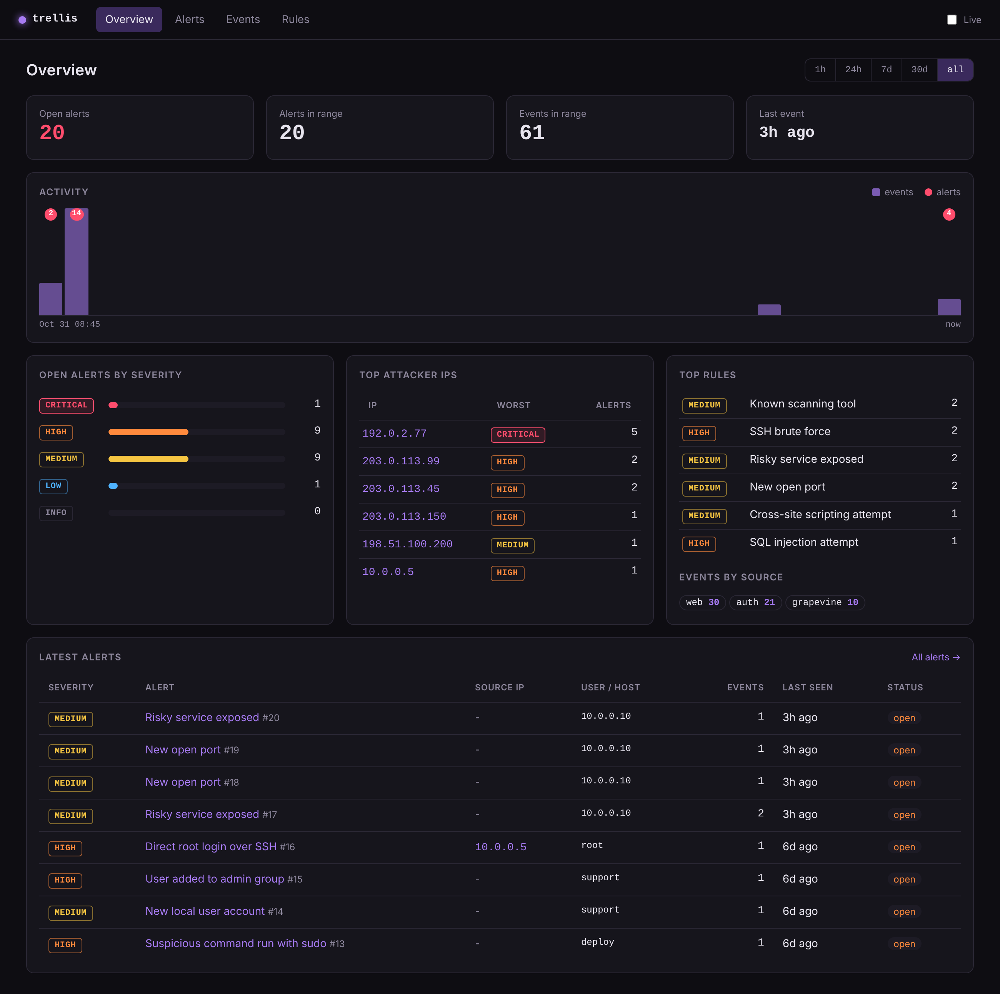
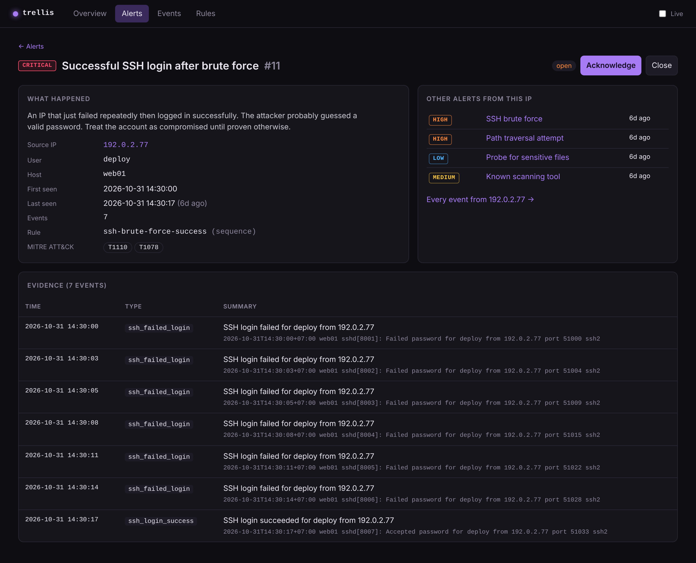

# Trellis

**Logs go in, alerts come out.** A small Security Information and Event
Management system written in Python, built to learn how tools like Splunk and
Wazuh actually work: collect logs from different sources, normalize them into
one shape, correlate events across time, and raise alerts a human can triage.

> Companion project to [grapevine](https://github.com/Garrickkk/GrapeVine), my
> port/network scanner. Trellis can read GrapeVine's scan output and alert when
> a host starts exposing a port it didn't before.



## What a SIEM does, and what this one does

A SIEM has four jobs. Trellis does a small version of each:

| Job | Real SIEM | Trellis |
|---|---|---|
| **Collect** logs from many sources | agents, syslog, APIs | reads log files (batch or live tail) |
| **Normalize** different formats into one | a common schema | every parser emits the same `Event` |
| **Detect** with correlation rules | SPL, Sigma, EQL | YAML rules: match / threshold / sequence / new-value |
| **Present** for investigation | web console | Flask dashboard + alert triage |

It is **not** production security tooling: it has no authentication, no agents,
and it trusts the logs it reads. It's a portfolio project for understanding the
moving parts.

## Install

Python 3.10+. Two dependencies: Flask for the dashboard and PyYAML for the
rule files. Everything else is the standard library.

```bash
pip install -r requirements.txt
```

## Quick start

Point it at the included sample logs — a complete attack story captured across
SSH, web, and network-scan logs:

```bash
# Read the server logs and print alerts as they fire
python -m trellis ingest samples/auth.log samples/access.log

# Then two GrapeVine scans of the server, a day apart: the first is the
# baseline, the second reveals the backdoor port the attacker opened
python -m trellis ingest samples/scan-baseline.txt
python -m trellis ingest samples/scan-latest.txt

# Open the dashboard at http://127.0.0.1:5000
python -m trellis serve
```

That one attack walks through: recon (Nikto, sqlmap) → SSH brute force →
a guessed password → root shell via sudo → `curl | bash` → a new backdoor
account → and finally a new open port the next GrapeVine scan picks up.

The sample logs are dated 31 October 2026, so if the overview looks empty,
switch the time range to **all**.

## Usage

```bash
python -m trellis ingest LOG [LOG ...]    # read logs once (safe to re-run)
python -m trellis watch  LOG [LOG ...]    # follow logs live, alert in terminal
python -m trellis watch  LOG --serve      # ...and run the dashboard at the same time
python -m trellis serve                   # just the dashboard
python -m trellis rules                   # validate and list detection rules
```

Formats are auto-detected, so you can mix them in one command. Force one with
`--type {auth,web,grapevine}` if detection guesses wrong.

| Option | Description |
|---|---|
| `--db PATH` | SQLite database file (default `trellis.db`) |
| `--rules PATH` | rules directory or single file (default `rules/`) |
| `--type` | force a log format instead of auto-detecting |
| `--from-start` | (watch) also process lines already in the file |
| `--host` / `--port` | (serve/watch) dashboard address |

Re-running `ingest` on the same file is safe: Trellis remembers how far it read
into each file (by inode and offset), so nothing is counted twice. Rotated or
truncated files are detected and re-read from the top. GrapeVine scan files are
treated as snapshots instead: when one changes, the whole file is read as a new
scan, so overwriting the same file every day works.

### Feeding it real logs

```bash
# Linux auth log (SSH, sudo, new users)
python -m trellis ingest /var/log/auth.log         # Debian/Ubuntu
python -m trellis ingest /var/log/secure           # RHEL/Fedora

# Web server access logs (nginx / Apache combined format)
python -m trellis ingest /var/log/nginx/access.log

# A GrapeVine scan — save it first, then ingest. Reusing the same file name
# every day is fine; the first scan of each host becomes its baseline.
python grapevine.py 192.168.1.0/24 > scans/today.txt
python -m trellis ingest scans/today.txt
```

To monitor continuously, leave a `watch` running:

```bash
python -m trellis watch /var/log/auth.log /var/log/nginx/access.log --serve
```

## Supported log sources

| Source | Format | Detects |
|---|---|---|
| **auth** | Linux `auth.log` / `secure` (classic and ISO syslog) | SSH logins & failures, sudo, new users, group changes |
| **web** | nginx / Apache "combined" access log | requests with method, path (URL-decoded), status, user-agent |
| **grapevine** | [GrapeVine](https://github.com/Garrickkk/GrapeVine) scan output (text or JSON lines) | open/closed/filtered ports with service and version |

Every line becomes a normalized `Event`:

```
timestamp  source  event_type  host  src_ip  user  message  raw  extra{...}
```

Rules only ever see this shape, so a rule doesn't care whether an IP came from
an SSH log or a web log. Adding a new source is one class in `parsers.py` — no
rule has to change.

## Detection rules

Rules are YAML, in `rules/`. They're loosely modeled on
[Sigma](https://github.com/SigmaHQ/sigma), the open standard for SIEM rules, so
the ideas transfer. There are four rule types:

**`match`** — one event is suspicious by itself.

```yaml
- id: web-sql-injection
  name: SQL injection attempt
  severity: high
  mitre: [T1190]
  type: match
  where:
    source: web
    path_decoded|regex: "union(\\s|/\\*.*\\*/)+(all\\s+)?select"
  group_by: [src_ip]
```

**`threshold`** — N matching events from the same group inside a time window.
With `distinct`, it counts *unique values* instead (one IP, many usernames):

```yaml
- id: ssh-brute-force
  name: SSH brute force
  severity: high
  type: threshold
  where: {event_type: ssh_failed_login}
  group_by: [src_ip]
  threshold: 5        # 5 failures...
  window: 60          # ...within 60 seconds
```

**`sequence`** — ordered steps from the same group inside a window. This is the
correlation that makes it a SIEM and not just a log grep:

```yaml
- id: ssh-brute-force-success
  name: Successful SSH login after brute force
  severity: critical
  type: sequence
  group_by: [src_ip]
  window: 900
  steps:
    - where: {event_type: ssh_failed_login}
      min_count: 5
    - where: {event_type: ssh_login_success}   # same IP, right after
```

**`new_value`** — a value never seen before. With `baseline_by`, the first
scan of each host is learned quietly so you only alert on genuine *changes*.
`baseline_batch` names the field that identifies one scan, so two scans are
told apart even if they share a timestamp:

```yaml
- id: new-open-port
  name: New open port
  severity: medium
  type: new_value
  where: {event_type: port_open}
  fields: [target, port]
  baseline_by: target      # first scan of a host = baseline, not an alert
  baseline_batch: scan_id  # one scan = one batch
```

### Condition syntax

Inside `where`, every condition must hold (AND). Operators go after a `|`:

| Written as | Means |
|---|---|
| `status: 404` | equals (a list means "any of") |
| `user\|not: root` | not equal |
| `path\|contains: "../"` | substring |
| `ua\|startswith: sqlmap` | prefix |
| `path\|regex: "union\\s+select"` | regex, case-insensitive |
| `status\|gte: 400` | numeric ≥ (also `gt`, `lte`, `lt`) |

`group_by` sets what "the same source" means (usually `src_ip`), and `suppress`
folds repeat alerts for the same group into one so 500 failed logins become a
single alert with 500 events attached, not 500 alerts. Suppression is checked
against the database, so it holds across separate runs; closing an alert ends
it, and the next occurrence opens a fresh alert.

Check your rules anytime:

```bash
python -m trellis rules
```

The 20 shipped rules cover SSH attacks, Linux privilege escalation and
persistence, common web attacks, and network-exposure changes. Every rule is
tagged with its [MITRE ATT&CK](https://attack.mitre.org/) technique, linked from
the dashboard.

## The dashboard

`python -m trellis serve`, then open <http://127.0.0.1:5000>.

- **Overview** — alert counts, an activity timeline, top attacker IPs, top
  rules, and the latest alerts.
- **Alerts** — filter by severity, status, or rule; acknowledge or close.
- **Alert detail** — the description, MITRE technique, every event that makes up
  the alert (the evidence), and *other alerts from the same IP*, so you can see
  the whole story (see below).
- **Events** — full-text search across every event, filter by source, type or IP.
- **Rules** — every loaded rule, its logic, and how many alerts it's raised.



## How it fits together

```
 log files ─▶ parsers ─▶ normalized Events ─▶ SQLite
                                   │
                                   ▼
                          detection engine ─▶ alerts ─▶ Flask dashboard
                        (match/threshold/
                         sequence/new_value)
```

- `event.py` — the one schema every parser produces.
- `parsers.py` — raw lines → `Event`s, plus format auto-detection.
- `rules.py` — YAML loading, condition compiling, and the stateful detector
  (sliding windows, sequence tracking, suppression).
- `storage.py` — SQLite for events, alerts, and ingestion offsets.
- `engine.py` — the pipeline tying it together (batch and live-tail).
- `web/` — the Flask dashboard.

## Design notes

- **Normalize first, detect once.** Every source collapses to one `Event`
  shape, so rules are written against fields, not formats. This is the single
  idea that makes a SIEM scale to many log types.
- **Correlation is the point.** Any `grep` finds a failed login. The value is
  in *failed logins then a success from the same IP*, or *the IP that scanned
  the website later logging in over SSH* — events that are only suspicious
  together, and only visible because every source lands in one place.
- **Idempotent ingestion.** File offsets are tracked so re-running never
  double-counts. This is also what lets `watch` tail a growing file.
- **State that must survive restarts is in SQLite** (new-value baselines,
  alert suppression); state that's cheap to rebuild (sliding windows) stays in
  memory and is swept periodically so long-running `watch` doesn't grow forever.
- **URLs are decoded before matching.** Attackers encode payloads (`%27`,
  double-encoded `%2527`) to dodge naive filters, so rules match the decoded
  path.

## Treating logs as hostile

A SIEM reads text that attackers partly control, so the parsers are written
defensively:

- **Log injection.** An SSH username is attacker-chosen and can contain spaces.
  Logging in as `x from 10.0.0.5 port 22` puts a fake address into the log line.
  Every SSH pattern is anchored to the *end* of the line, where sshd writes the
  real address, so the attack is pinned on the true source. (fail2ban had
  this exact class of bug.)
- **Parser evasion.** Apache logs a `"` inside a URL as `\"`. A naive regex
  stops at the escaped quote, fails to parse the line, and the request
  vanishes. Escapes are handled, then decoded before detection.
- **No single line can stop ingestion.** A malformed or impossible line is
  skipped, not fatal.
- **The dashboard escapes everything.** Log text like `<script>` in a
  User-Agent is rendered as text, never as HTML. Status changes check the
  request's origin exactly, and redirects only go to local paths.

## Running the tests

```bash
pip install pytest
pytest
```

The suite covers each parser, every rule type in isolation, suppression and
idempotent ingestion, an end-to-end run of the sample attack through the
whole pipeline, and `tests/test_regressions.py`: a test for every bug found in
review, written to fail before its fix.

## Roadmap

- [ ] GeoIP and ASN enrichment on source IPs
- [ ] Email / webhook notifications on high-severity alerts
- [ ] A compare mode for two GrapeVine scans (ports opened *and* closed)
- [ ] More sources: Windows Event Logs (4625, 4688), firewall logs
- [ ] An alert → case grouping so related alerts share one investigation

## A note on comparing it to a real SIEM

The companion exercise to this project is to run the *same* sample attack
through Wazuh or Splunk in a homelab and compare what each catches. Trellis
makes the mechanics legible; the real tools show you what production-grade
collection, scaling, and rule libraries add on top.

## Legal

Only collect and analyze logs from systems you own or are authorized to
monitor. Attacker IPs in the samples are from the documentation ranges
(RFC 5737), so they belong to no one.
